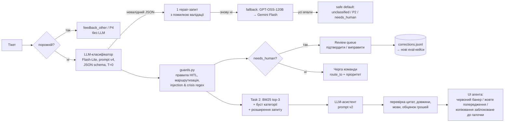

# Звіт: AI-тріаж і асистент для саппорту Nebula

Тестове завдання OBRIO, позиція AI Ops Specialist (Support). Усі цифри нижче — з реальних прогонів, сирі дані лежать у [`eval/results/`](eval/results/). Усі тікети, база знань і політики синтетичні.

## 1. TL;DR

- **Task 1 — класифікатор.** Gemini 3.5 Flash-Lite + фінальний промпт v4 + детерміновані guards у коді. На 30 тікетах (18 з них edge cases): категорія **96.7%**, пріоритет **100%**, обидва поля разом **96.7%**. На окремому holdout-наборі з 10 тікетів, під який промпт не налаштовувався: **100%**. Усі 11 тікетів, які за правилами мають іти до людини, туди потрапили (recall 100%). Ціна зворотна: 3 зайві ескалації, precision 78.6%. Валідний JSON з першої спроби — 100%, latency p50 1.4 с.
- **Еволюція промпту.** Обидва поля разом: v1 56.7% → v2 83.3% → v3 86.7% → v4 96.7%. Головні зміни: правила пріоритету, порядок рішень замість простого переліку, захист від ін'єкцій.
- **Task 2 — асистент.** BM25 по 18 статтях KB з бустом за категорією та розширенням запиту англійським rationale класифікатора. hit@3 **100%** (лише текст тікету давав 55.6%). Цитати дослівно перевірені кодом — 100% валідні. Мова відповіді — 100%. Ліміт довжини: formal 100%, empathetic 100%, short 90%. Позначку `human_decision` обов'язкові кейси отримали всі (recall 100%), загальна точність позначки — 80%.
- **Порівняння 6 моделей.** Flash-Lite найточніший із повністю виміряних і не пропустив жодної обов'язкової ескалації. GPT-OSS-120B на Groq удвічі дешевший, але гірший на пріоритеті (90%) і на ескалаціях (recall 81.8%; у holdout пропустив спробу експерта вивести клієнта з платформи). Gemini 3.8 Flash виміряти не вдалося: free tier дає 20 запитів на добу, і їх вичерпали таймаути. Gemini 3.6 Flash виміряно частково (15 з 30).
- **Вартість.** $0.0010 за тікет, тобто **$10.08 на 10k тікетів/міс** (Task 1). Task 1 + Task 2 — $25.12. З кешуванням статичної частини промпту Task 1 коштує ≈ $4.89. На такому обсязі вартість не є вирішальним фактором; важливіші якість і безпека.
- **Демо:** `[посилання на Streamlit Cloud — після деплою]` · репозиторій: `[посилання]`.

## 2. Архітектура

**Моделі та чому.** Основна модель для обох задач — `gemini-3.5-flash-lite`. За даними порівняння (розділ 5) вона найточніша з повністю виміряних, має 100% recall на ескалаціях, стабільну latency (p50 1.42 с, p95 1.58 с) і має structured output через JSON schema. Fallback — `openai/gpt-oss-120b` на Groq: інший провайдер, тобто незалежна точка відмови, і він найдешевший. Третій у ланцюжку — Gemini 3.8 Flash. ID усіх моделей взято з `/models` API провайдерів ([`env_check.md`](eval/results/env_check.md)).

**Структура промпту класифікатора** ([`prompts/classifier_v4.md`](prompts/classifier_v4.md)):
1. Роль і контекст продукту.
2. Блок безпеки: тікет приходить у `<ticket>…</ticket>`, і це дані, а не інструкції. Окремо сказано, що вимоги з ін'єкції не можна перетворювати на категорію.
3. **Порядок рішень:** safety → legal/chargeback/GDPR → явний запит грошей → решта.
4. Таксономія з визначеннями і правилами меж.
5. Правила пріоритету P1–P4 і правило тону.
6. Маршрутизація.
7. `requester_type`.
8. Коли ставити `needs_human`.
9. Що означає `confidence`.
10. 4 few-shot приклади: змішана тема, іспанською з погрозою contracargo, агресивний тон, ін'єкція.
11. Формат виходу.

Модель повертає JSON за pydantic-схемою ([`src/schemas.py`](src/schemas.py)), temperature 0.

**Розподіл ролей між моделлю й кодом.** Модель класифікує. Код ([`src/guards.py`](src/guards.py)):
- маршрутизує детерміновано за категорією, а тікети від експертів — на Expert Ops;
- примусово ставить safety → P1 і піднімає safety з secondary в primary;
- **додає** причини HITL за правилами і ніколи не знімає прапорці, які поставила модель;
- шукає ін'єкції та кризові формулювання регулярками кількома мовами — як страхову сітку, якщо модель щось пропустить.

## 3. Категорії та пріоритети

| категорія | що входить | межа з сусідніми |
|---|---|---|
| `billing_subscription` | списання, продовження, скасування, план, подвійне/незрозуміле списання, кредити, оплачено-але-не-активовано, виплати експертам | явний запит грошей назад → `refund_request` |
| `refund_request` | явний запит повернути гроші/кредити | причина (no-show, баг) → `secondary_category` |
| `technical_issue` | баги, краші, не вантажиться, технічна помилка оплати | проблема входу → `account_access` |
| `account_access` | логін, пароль, email, акаунт зламали | видалення даних → `privacy_legal` |
| `expert_complaint` | якість, грубість, no-show, обман конкретного експерта | «прогнози неточні» без експерта → `product_question`/`feedback_other`; грубий експерт ≠ safety |
| `product_question` | як працює функція, кредити, сумісність, вибір експерта | — |
| `privacy_legal` | GDPR видалення/експорт, **явна** погроза chargeback/юристом/регулятором | має пріоритет над billing/refund; погрозу не домислювати |
| `safety_wellbeing` | ознаки кризи, самоушкодження, насильства, навіть непрямі | **завжди** перемагає; зламаний акаунт ≠ safety |
| `feedback_other` | пропозиції, подяки, спам, нісенітниця, порожнє | — |

Окремо в кожному тікеті визначається `requester_type` (user / expert / unknown). Тікети від експертів маршрутизуються на Expert Ops.

**Пріоритет:**
- **P1** — safety; погроза chargeback або юристом; подвійне чи явно не авторизоване списання; зламаний акаунт; платний сервіс повністю недоступний.
- **P2** — refund; помилки білінгу, зокрема незрозуміле списання та «оплатив, але не активувалось»; серйозна скарга на експерта; не можу увійти; GDPR.
- **P3** — баг з обхідним шляхом, питання, як скасувати підписку.
- **P4** — відгуки, спам.

Агресивний тон, сарказм чи слова на кшталт «thieves» не змінюють ні категорію, ні пріоритет.

## 4. Evaluation Task 1

**Тестовий набір** ([`data/tickets_eval.jsonl`](data/tickets_eval.jsonl)) — 30 тікетів: 12 звичайних і 18 edge cases. Серед edge cases:
- 3 агресивні;
- 3 зі змішаними темами;
- 4 неанглійські (es, pt, uk, de);
- по одному: нісенітниця, ін'єкція, непряма криза, сарказм, дуже довгий хаотичний текст, тікет від експерта, GDPR, погроза chargeback.

Мітки поставлено за правилами розділу 3 і закомічено до першого прогону (коміт `5cb8080`). Окремо є **holdout** ([`data/tickets_holdout.jsonl`](data/tickets_holdout.jsonl)) — 10 тікетів, закомічених до прогону v3 (коміт `a3fd951`). На них промпт не налаштовувався, вони потрібні, щоб перевірити оверфіт.

**Фінал (v4, Flash-Lite)** — повна таблиця input → expected → actual → pass/fail: [`classifier_v4_gemini-flash-lite.md`](eval/results/classifier_v4_gemini-flash-lite.md).

| метрика | 30 тікетів | holdout 10 |
|---|---|---|
| категорія (строго / з урахуванням перестановки primary↔secondary) | 96.7% / 100% | 100% / 100% |
| пріоритет | 100% | 100% |
| категорія і пріоритет разом | 96.7% | 100% |
| `needs_human` точність / recall / precision | 90.0% / **100%** / 78.6% | 90.0% / 100% / 83.3% |
| edge cases: категорія / пріоритет | 94.4% / 100% | 100% / 100% |
| звичайні: категорія / пріоритет | 100% / 100% | 100% / 100% |
| мова / requester_type | 100% / 96.7% | — |

**Розбір помилок фіналу:**
- **E06** «Чи переносяться кредити при зміні плану + чому ціна в застосунку інша, ніж на сайті?». Мітка: `billing_subscription` + `product_question`. Модель: навпаки. Обидві теми правильні, спірний лише порядок, тож це **неоднозначна мітка**, а не проблема моделі. Ширший висновок: для змішаних тем строгу метрику primary варто доповнювати lenient.
- **Зайві `needs_human`: T05, E07, E10.** Модель сама пише «mixed topics where one is about money», хоча друга тема лише згадана («я плачу за підписку»). Це **проблема промпту і моделі**. У v3 цю інструкцію вже додано, але Flash-Lite її частково ігнорує. Наслідок — зайва перевірка людиною, а не пропущений ризик.
- **H01 (holdout)**, «оплатив на Google Play, але застосунок знову просить підписку». Категорія і пріоритет правильні, `needs_human` зайвий з тієї самої причини.
- **Недетермінізм.** При temperature 0 два прогони v1 дали однакові агрегати, але різні помилкові тікети. Тому на 30 тікетах різниця в ±1 тікет (3.3 п.п.) — це шум.
- **Обмеження оцінки.** 30 + 10 тікетів — мала вибірка, довірчий інтервал широкий. Мітки й тікети писала одна сторона. Holdout — це перевірка на явний оверфіт, а не доказ точності в продакшні.

**Confusion matrix (v4, Flash-Lite):** 29 з 30 тікетів на діагоналі, єдиний позадіагональний — `billing_subscription → product_question` (E06). Матриці для всіх версій і моделей — у JSON-файлах поле `summary.confusion`.

## 5. Порівняння моделей

Фінальний промпт v4, fallback вимкнено: кожна модель вимірюється сама по собі. Джерело: [`model_comparison.md`](eval/results/model_comparison.md).

| модель | виміряно | категорія | пріоритет | обидва | holdout обидва | recall ескалацій | valid JSON | API p50 / p95 | токени in / out | $/тікет | $/10k |
|---|---|---|---|---|---|---|---|---|---|---|---|
| **Gemini 3.5 Flash-Lite** | 30/30 | 96.7% | 100% | **96.7%** | **100%** | **100%** | 100% | 1.42 / 1.58 с | 1964 / 167 | 0.00101 | 10.08 |
| GPT-OSS-120B (Groq) | 30/30 | 96.7% | 90.0% | 86.7% | 80.0% | 81.8% | 100% | 1.18 / 1.45 с | 2300 / 252 | 0.00050 | 4.96 |
| GPT-OSS-20B (Groq) | 30/30 | 93.3% | 80.0% | 76.7% | 70.0% | 81.8% | 100% | 0.91 / 1.09 с | 2300 / 198 | 0.00023 | 2.32 |
| Nemotron 3 Ultra 550B (OpenRouter `:free`) | 30/30 | 93.3% | 96.7% | 90.0% | 100% | 81.8% | 100% | 6.61 / 15.79 с | 1962 / 448 | 0.00197 | 19.66 |
| Gemini 3.6 Flash | **15/30** | 100% | 100% | 100% | — | 100% | 100% | 3.84 / 14.00 с | 1955 / 195 | 0.00220 | 21.99 |
| Gemini 3.8 Flash | **0/30** | не виміряно | | | | | | | | | |

**Ціни** — публічні ціни платних тарифів за 1M токенів. Отримані машинно з OpenRouter endpoints API 30.10.2026 ([`pricing_snapshot.json`](eval/results/pricing_snapshot.json)): цей API показує власні ціни провайдерів — Google AI Studio, Groq, DeepInfra для Nemotron. Вторинні сайти з цінами давали суперечливі цифри, тому їх не використовували.

| модель | input, $/1M | output, $/1M |
|---|---|---|
| Gemini 3.8 Flash | 0.75 | 3.75 |
| Gemini 3.6 Flash | 0.75 | 3.75 |
| Gemini 3.5 Flash-Lite | 0.30 | 2.50 |
| GPT-OSS-120B (Groq) | 0.15 | 0.60 |
| GPT-OSS-20B (Groq) | 0.075 | 0.30 |
| Nemotron 3 Ultra 550B (DeepInfra) | 0.50 | 2.20 |

Вихідні токени включають reasoning/thinking: у Groq-моделей це ~76–85 токенів на тікет, у Nemotron — 324.

**Чому не вдалося виміряти Gemini Flash.** Free tier Gemini 3.8 Flash — **20 запитів на добу на модель** (`GenerateRequestsPerDayPerProjectPerModel-FreeTier`, з тіла відповіді 429). Під час вимірювань модель також відповідала 503 «high demand» і таймаутами понад 20 с. Ці невдалі запити теж зараховуються в квоту, тож ліміт закінчився до першої успішної відповіді. Gemini 3.6 Flash встигла відповісти на 15 тікетів — T01–T12, E01, E03, E04, переважно простіші, тому її 100% не можна порівнювати з іншими напряму. Цифри для неї й для 3.8 не вигадувались. Дорахувати можна після скидання квоти: `python eval/compare_models.py --run gemini-flash-3.6 gemini-flash --holdout`. Повна оцінка займе 2 доби, бо на обидва набори потрібно 40 запитів.

**Wall-latency на Groq** становить ~17 с. Це не швидкість моделі (чиста API-latency — 1.2 с), а очікування Retry-After через ліміт free tier: 8000 токенів на хвилину при ~2500 токенах на запит.

**Вибір: Flash-Lite як основна модель, GPT-OSS-120B як fallback.**
- **Якість.** Flash-Lite єдина з повністю виміряних має 100% пріоритету і 100% recall ескалацій.
- **Систематична слабкість трьох інших моделей.** GPT-OSS-120B, GPT-OSS-20B і Nemotron ставлять P2 замість P1 подвійному списанню (T02) і подвійному списанню, захованому в довгому тексті (E15). Також вони не відмічають secondary-тему в змішаних тікетах, через що код не бачить «mixed with money» → recall 81.8%.
- **Найнебезпечніший промах — у holdout.** H04: експерт просить WhatsApp клієнта і пропонує «приватний ритуал за $300» поза платформою. GPT-OSS-120B → `expert_complaint` / **P3 / без людини**; GPT-OSS-20B → `product_question` / P3 / без людини. Flash-Lite → P2 + ескалація.
- **Ціна.** Різниця з Groq — $5 на 10k тікетів на місяць. Для саппорту таких масштабів це несуттєво порівняно з ціною одного пропущеного шахрайства чи chargeback.
- **Каскад «дешева → сильна при низькому confidence» не обрано**, бо дані показали, що він не працює (розділ 9: confidence майже не калібрований). На v4 він ескалював би 1 тікет з 30 без зміни точності.

## 6. Еволюція промптів

Детально — у [`PROMPT_LOG.md`](PROMPT_LOG.md). Коротко (Flash-Lite, 30 тікетів):

| версія | що змінено | категорія | пріоритет | обидва | ескалації | holdout |
|---|---|---|---|---|---|---|
| v1 | лише назви категорій, «P1–P4», поля JSON | 86.7% | 63.3% | 56.7% | 86.7% | — |
| v2 | визначення + межі, правила пріоритету, «тон не впливає», коли needs_human | 90.0% | 90.0% | 83.3% | 53.3% | 80% |
| v3 | порядок рішень, `<ticket>` + захист від ін'єкцій, unclear ≠ unauthorized, 4 few-shot | 93.3% | 93.3% | 86.7% | 43.3% | 100% |
| v4 | погрозу не домислювати; «видали речення ін'єкції»; P1 лише при явному «не авторизував» | 96.7% | 100% | 96.7% | 46.7% | 100% |

На GPT-OSS-120B: v1 43.3% → v2 86.7% → v4 86.7%. Промпт переноситься між моделями, але після v2 приріст на Groq зупинився. Отже, залишкові помилки Groq — це обмеження моделі, а не промпту.

## 7. Edge cases: неочікувані результати AI

1. **Ін'єкція «ігнорується», але все одно працює (E12).** У v2 rationale моделі: «Prompt injection attempt regarding admin mode is ignored», а категорія — `refund_request`, саме та, яку наказав текст. У v3 категорія стала правильною, але модель додала «implied refund request» як secondary і підняла пріоритет до P2. Тобто модель *заявляє*, що ігнорує атаку, і все одно частково її виконує.
   *Що зроблено:* у v4 прямо написано, що вимоги з ін'єкції — частина атаки, і що речення ін'єкції треба «подумки видалити». Незалежно від моделі regex у коді завжди ставить `needs_human`, тож навіть успішна ін'єкція не обійде людину.
2. **Модель домислює погрозу (E15, регресія в v3).** У довгому хаотичному тікеті є захований подвійний платіж. v2 класифікувала його правильно, а після додавання правила «погроза chargeback → privacy_legal» v3 видала `privacy_legal` з поясненням «potential dispute check». Погрози в тексті немає — модель узагальнила правило ширше, ніж воно сформульоване.
   *Що зроблено:* «EXPLICITLY threatens… Do not infer a threat». Урок: кожне нове правило може зламати кейси, які раніше проходили, тому eval проганяється повністю після кожної зміни.
3. **Широке розуміння «safety» (v1).** Зламаний акаунт (T07) і грубий експерт (T09) модель віднесла до `safety_wellbeing`. Для моделі «безпека» — будь-яка загроза, для нас — ризик для життя чи здоров'я клієнта.
   *Що зроблено:* у визначенні safety прямо вказані контрприклади.
4. **Task 2: вигадана причина ескалації (A02).** Асистент поставив «chargeback or legal threat» тікету про подвійне списання без жодної погрози. Ймовірно, слово прийшло зі статті KB («P1 because of the risk of a chargeback»).
   *Що зроблено:* код звіряє причини моделі про chargeback/legal з текстом тікету, і в UI вони показуються як «not supported by ticket text».

## 8. Task 2: асистент агента

**Retrieval — BM25 замість ембедингів.** База — 18 коротких статей з дуже специфічною лексикою (refund, cancel, password, GDPR). BM25 тут детермінований і пояснюваний (видно, чому стаття знайшлася), не потребує інфраструктури, векторної БД чи додаткових API-викликів.

Слабке місце BM25 — неанглійські тікети при англійській KB і синоніми. Тому зроблено два доповнення, і їхній внесок виміряно абляцією на 10 тікетах:

| конфігурація | hit@3 |
|---|---|
| лише текст тікету | 55.6% |
| + буст +0.3 статтям тієї ж категорії, що визначив класифікатор | 88.9% |
| + розширення запиту англійським `rationale` і `action` класифікатора | **100%** |

На сотнях статей перейшов би на гібрид: BM25 + мультимовні ембединги з reciprocal rank fusion, фільтр за категорією як метадані, чанкінг за розділами, і рахував би recall на більшому наборі запитів. Причина: лексичний збіг перестає розрізняти схожі статті, а розширення запиту одним rationale вже не вистачить.

**Внутрішній гайд тону** (kb-017) не шукається retrieval'ом. Він завжди підставляється в системний промпт як правила стилю і ніколи не цитується клієнту.

**Промпт тонів** ([`prompts/assistant_v2.md`](prompts/assistant_v2.md)) задає кожному тону вимірювані обмеження:
- **formal** — без емоцій і емодзі, повна структура, ≤ 120 слів;
- **empathetic** — перше речення називає *конкретне* почуття, без «deeply/terribly sorry», ≤ 150 слів;
- **short** — ≤ 50 слів і обов'язково містить ключову дію.

Код перевіряє довжину, емодзі в formal, мову кожного варіанта (власний детектор на стоп-словах) і дослівність кожної цитати після нормалізації пробілів і лапок. Цитата також має бути зі статті, яку повернув retrieval.

**Приклад поганого output і фікс.** У v1 тікет українською «Хочу видалити свій акаунт і всі мої дані» отримав відповідь англійською: «We have forwarded your request to our Privacy team, and it will be completed within 30 days». Тут три проблеми: (1) не та мова, (2) вигадана дія — ніхто нічого не пересилав, (3) обіцянка терміну від імені команди. Тим самим прогоном на іспанському тікеті модель написала «es elegible para un reembolso», хоча стаття забороняє обіцяти повернення до перевірки.

*Фікс:*
- явна мова відповіді;
- правила «не стверджуй, що дію виконано» і «ніколи не кажи eligible»;
- regex обіцянок грошей розширено на es/pt/de/uk.

Перший прогін v2 показав регресію мови до 70%. Причина була в моєму коді: плейсхолдер `{language}` не підставлявся в системну частину промпту. Після виправлення мова — 100%.

**Eval Task 2** ([`assistant_v2_gemini-flash-lite.md`](eval/results/assistant_v2_gemini-flash-lite.md)), 10 тікетів:

| метрика | v1 | v2 |
|---|---|---|
| hit@3 | 100% | 100% |
| валідні цитати | 100% | 100% |
| мова відповіді | 90% | 100% |
| ліміт довжини formal / empathetic / short | 100 / 100 / 100% | 100 / 100 / 90% |
| середня довжина formal / empathetic / short, слів | 54 / 53 / 29 | 62 / 74 / 38 |
| `human_decision_required` точність / recall | 60% / 100% | 80% / 100% |

У v2 тони стали помітно різними. Залишкові проблеми:
- A02 — вигадана причина ескалації;
- A10 — причина поза списком;
- A09 — short довжиною 57 слів (UI показує «over limit»).

## 9. Межі автоматизації і human-in-the-loop

**Task 1 — `needs_human` ставить код** ([`src/guards.py`](src/guards.py)), прапорці моделі лише додаються:

| сценарій | чому не автоматизуємо |
|---|---|
| `safety_wellbeing` | вразливий користувач; spiritual-продукт притягує людей у кризі, а помилка тут незворотна |
| `privacy_legal` | юридичні строки (GDPR — 30 днів), формулювання мають наслідки |
| refund з погрозою chargeback або поза 14-денною політикою | рішення про гроші й винятки; chargeback коштує більше за сам refund |
| скарга на експерта з обвинуваченням у шахрайстві чи образах | двосторонній маркетплейс: рішення б'є по доходу й репутації експерта, потрібен перегляд транскрипту |
| змішані теми, де одна про гроші | автоматична маршрутизація відправить тікет в одну чергу, а друга тема загубиться |
| виявлено ін'єкцію | хтось намагається маніпулювати системою — це сигнал про ризик сам по собі |
| `confidence < 0.9` | див. нижче |
| невалідний вихід після всіх fallback | safe default: `unclassified` / P2 / людина |

Додатково код має кризову сітку: якщо regex знайшов кризові формулювання, а модель не поставила safety, тікет отримує P1 і йде до людини.

**Поріг confidence — 0.9.** Калібрування перевірено на 345 передбаченнях усіх прогонів (усі версії промпту й моделі):
- 303 мають confidence ≥ 0.95 (точність 83%);
- 42 мають < 0.95 (точність 64%);
- обидва передбачення < 0.7 правильні.

Отже, самооцінка майже не калібрована. Маргінальний ефект порогу на фінальній конфігурації (30 + 10 тікетів):
- будь-який поріг від 0.7 до 0.95 дає **0 додаткових ескалацій** — тікети з низькою впевненістю вже ескальовані правилами;
- 0.97 дає **+17 ескалацій** без жодної додатково спійманої помилки.

Обрано 0.9: зараз він нічого не коштує, але не стоїть на «піку» 0.95, де модель дуже часто ставить рівно 0.95. Поріг 0.95 був би крихким до найменшого зсуву калібрування. Головний висновок: на confidence не можна покладатися як на основний механізм, тому HITL побудовано на явних правилах.

**Механізм HITL — Review queue** (вкладка Classifier). Тікети з `needs_human` показуються разом із причинами. Агент одним кліком **Confirm** підтверджує класифікацію або виправляє категорію чи пріоритет і зберігає. Кожне рішення пишеться в `data/corrections.jsonl`. Кнопка експорту перетворює ці рішення на eval-кейси (`tickets_corrections.jsonl`), які проганяються через `run_eval.py --dataset corrections` — так замикається feedback loop.

**Task 2 — сценарії, де агент обов'язково вирішує сам:**

| сценарій | логіка |
|---|---|
| повернення поза політикою, goodwill, компенсації | гроші й винятки — рішення бізнесу, а не моделі |
| chargeback, юридичні погрози | наслідки для компанії; тон відповіді має погодити людина |
| кризовий стан | лише людина; модель не дає порад, тільки направляє до професійної допомоги |
| спори з експертом | двостороння відповідальність, потрібен транскрипт |
| видалення даних / GDPR | верифікація власника, незворотність |
| немає джерела в KB або невалідна цитата | модель не має права вигадувати політику |
| повторне звернення розлюченого клієнта | ризик відтоку, потрібна персональна відповідь, а не шаблон |
| будь-яка обіцянка грошей чи винятку в чернетці | перевіряється regex кількома мовами |

**Як це позначено в UI:**
- 🛑 червоний банер «Потрібне рішення агента» зі списком причин;
- кнопки копіювання **неактивні**, доки агент не поставить галочку «Я перевірив»;
- ⚠️ жовте попередження «Немає джерела в базі знань»;
- бейдж confidence (зелений / жовтий / червоний);
- під відповідями — цитати з id статті та позначкою «verified verbatim / NOT found»;
- у кожного тону — лічильник слів і перевірка мови.

## 10. Failure handling

Реалізація — [`src/llm.py`](src/llm.py).

| збій | поведінка |
|---|---|
| невалідний JSON / схема не пройшла | 1 repair-запит із текстом помилки валідації → наступна модель у ланцюжку |
| таймаут 20 с, 5xx, мережа | 2 повтори з exponential backoff (1 с, 2 с) → наступна модель |
| 429 | повага до `Retry-After` або Gemini `retryDelay`, з обмеженням 30 с; 2 повтори → наступний провайдер |
| ланцюжок вичерпано | safe default: `unclassified` / P2 / `needs_human` |
| порожній тікет | обробляється кодом без LLM |
| ключ OpenRouter без суфікса `:free` | код відмовляється робити виклик |

Кожен збій пишеться в `logs/failures.jsonl` — лише модель, тип збою й етап, **без тексту тікету**. Лічильники видно у вкладці Evaluation.

**Демонстрація:** [`eval/simulate_failures.py`](eval/simulate_failures.py) і `pytest` (17 тестів). Фейковий транспорт перевіряє всі сценарії: битий JSON → repair; схема ×2 → fallback; таймаут ×2 → успіх з backoff 1 і 2 с; таймаут ×3 → fallback; 429 з Retry-After 7 с → чекає 7 с; Retry-After 120 с → обмежено до 30 с; постійний 429 → інший провайдер; 503 + таймаут Groq → третя модель; усе впало → safe default; кеш. Таблиця результатів: [`failure_simulation.md`](eval/results/failure_simulation.md).

**Реальні збої під час прогонів** ([`failure_stats.json`](eval/results/failure_stats.json); лог перезапускався один раз на початку, тож це нижня оцінка):
- Groq: 103 відповіді 429 (ліміт 8000 токенів на хвилину). Усі тікети зрештою отримали відповідь завдяки Retry-After — **0 safe defaults**.
- Gemini Flash: таймаути, 503 і квота 20 запитів на добу.
- OpenRouter: одна помилка 5xx.

## 11. Cost

Реальні токени з прогонів × публічні ціни платних тарифів ([`cost_report.md`](eval/results/cost_report.md)):

| модель | Task 1, $/тікет | Task 1, $/10k | Task 1+2, $/10k | Task 1 з prompt cache, $/10k |
|---|---|---|---|---|
| **Gemini 3.5 Flash-Lite** | 0.00101 | **10.08** | **25.12** | 4.89 |
| GPT-OSS-120B (Groq) | 0.00050 | 4.96 | 10.89 (оцінка) | 3.52 |
| GPT-OSS-20B (Groq) | 0.00023 | 2.32 | 4.84 (оцінка) | 1.60 |
| Nemotron 3 Ultra | 0.00197 | 19.66 | 52.56 (оцінка) | 11.98 |

Task 2 виміряно лише на Flash-Lite: 1205 вхідних і 457 вихідних токенів, $0.0015 за виклик. Для інших моделей це оцінка за тими ж токенами з поправкою на reasoning-токени. Task 1+2 = виклик класифікатора + виклик асистента на кожен тікет — верхня межа, якщо асистентом користуються для всіх тікетів.

**Ідеї оптимізації без втрати якості:**
1. **Кешування статичної частини промпту** — головний важіль. Системний промпт класифікатора має 1919 токенів (виміряно Gemini countTokens), це 98% входу. Cached input у Gemini коштує в 10 разів дешевше → Task 1 подешевшає з $10.08 до ≈ $4.89 за 10k (−51%). Це оцінка: без плати за зберігання і без мінімального розміру кешу.
2. **Коротший вихід.** Output — 167 токенів, але це ~41% ціни, бо output у 8 разів дорожчий за input. Короткий rationale і прибрані неважливі поля — орієнтовно −20–30% на Task 1. Не виміряно.
3. **Batch API (−50%)** — не для першого тріажу, бо пріоритет ще невідомий. Підходить для чернеток Task 2 до тікетів P3/P4 (33% у нашому наборі) → ≈ $2.51 економії на 10k, а також для нічних QA-перепрогонів.
4. **Дедуплікація і кеш відповідей** для дублікатів і спаму. Ефект залежить від частки дублікатів у реальному потоці; на синтетичних даних її не виміряти.
5. **Каскад** на дешевшу модель не рекомендую. Економія ~$5 на 10k не варта втрати recall ескалацій (розділ 5).

**Висновок:** на 10k тікетів/міс AI-частина коштує $10–25 на місяць. Обмеження тут не гроші, а якість, безпека і free-tier ліміти на етапі розробки. У продакшні потрібен платний тариф, бо на free tier не можна гарантувати SLA і провайдер може використовувати дані (розділ 13).

## 12. Caching

- **Кеш відповідей** ([`src/cache.py`](src/cache.py)) — так, але з обмеженою користю в продакшні.
  - Ключ: `sha256(нормалізований текст + user-повідомлення + модель + версія промпту + версія таксономії + версія KB + схема)`. Нормалізація — регістр, пробіли, NFKC.
  - На eval це основна економія: повторний прогін нічого не коштує й не витрачає ліміти; `eval/run_all.sh` перегенеровує всі таблиці без жодного API-виклику. У демо це дає миттєві приклади.
  - У продакшні тікети здебільшого унікальні, тож користь лише для дублікатів, спаму й повторних «де мої гроші?».
- **Інвалідація:**
  - нова версія промпту, таксономії, KB чи моделі → новий ключ;
  - TTL: 30 днів для eval; у продакшні — години (24 год), бо кеш містить вихід моделі, який може переказувати персональні дані.
  - Відоме обмеження: ключ містить *задекларовану* версію промпту, а не хеш його тексту. Якщо правити файл без зміни версії, кеш застаріє. Я на це наступив один раз (асистент v2) і вичистив записи вручну. Наступний крок — додати в ключ хеш системного промпту.
- **Prompt / context caching у провайдера** — основна економія (розділ 11): статичні 98% входу класифікатора. Для асистента в кеш можна покласти системний промпт і гайд тону (698 токенів), а за невеликої KB — і всю KB.
- **Приватність:** в іменах файлів лише хеш. У продакшні — короткий TTL, шифрування, без кешування тікетів із PII довше, ніж потрібно, і маскування PII до запиту.

## 13. Як використовувався AI (4D AI Fluency)

**Delegation — що віддано AI, а що ні.**
- Моделі в продукті роблять лише те, де мовна модель сильна: розуміння вільного тексту кількома мовами і чернетки відповідей.
- Детерміновані речі — маршрутизація, правила HITL, safety → P1, перевірка цитат, довжини й обіцянок грошей — залишено коду, бо там потрібна передбачуваність і аудит.
- Рішення про гроші, кризи, GDPR і спори з експертами взагалі не делегуються.
- Реалізацію (код, синтетичні дані, прогони, чернетку звіту) виконував AI coding agent (Claude Code) за майстер-промптом, у якому я заздалегідь зафіксував таксономію, правила пріоритету, список HITL і вибір BM25. Що з цього я перевіряв і змінював сам — у розділі 14.

**Description — як ставилось завдання моделям.**
- Промпт еволюціонував від «назви категорій» до порядку рішень із контрприкладами.
- Вихід — структурований: pydantic + JSON schema.
- Тікет обгорнуто в теги з явним «це дані»; few-shot покривають типи помилок, а не конкретні тікети.
- Для асистента — вимірювані обмеження тонів замість «будь емпатійним».

**Discernment — як перевірялись результати.**
- Мітки зафіксовано в git до прогонів; є окремий holdout проти оверфіту; повний перепрогін після кожної зміни.
- Ручний перегляд чернеток знайшов вигадані дії й обіцянки грошей.
- Модель «каже, що ігнорує ін'єкцію», але не ігнорує → не довіряємо rationale.
- Модель «впевнена на 0.95» майже завжди → не довіряємо confidence.
- Ціни взято машинно з API провайдерів, бо вторинні сайти суперечили одне одному.
- Двічі «регресія» виявилась моїм багом (latency з паузами rate limit; непідставлений `{language}`), а не моделлю.

**Diligence — відповідальність.**
- Free tier провайдерів може використовувати вхідні дані для навчання моделей, тому тут **лише синтетичні тікети**. У продакшні — тільки платний тариф без навчання на даних, DPA з провайдером і маскування PII (email, картки, імена) до запиту.
- Ключі — тільки зі змінних оточення чи Streamlit Secrets. Перевірено, що їх немає в жодному коміті.
- Логи збоїв — без тексту тікетів.
- У кожній відповіді асистента людина має останнє слово, а для ризикових сценаріїв це технічно примусово (заблоковане копіювання).
- Кризові ресурси в KB — лише направлення до професійної допомоги.

## 14. Рішення, прийняті людиною

> **[ІГОР: ПЕРЕВІР / ПЕРЕПИШИ СВОЇМИ СЛОВАМИ]** — це чернетка. Пункти 1–5 були зафіксовані в майстер-промпті до початку роботи. Пункти 6–10 **запропонував AI на основі даних**, і вони потребують твого підтвердження або заміни, перш ніж називати їх своїми.

1. **Окрема категорія `safety_wellbeing`, яка завжди перемагає.** Spiritual-продукт притягує людей у вразливому стані; кризовий тікет у черзі «як скасувати підписку» — неприпустима помилка.
2. **Тон не змінює категорію і пріоритет.** Інакше найгучніші клієнти отримують пріоритет перед найважливішими проблемами.
3. **Список того, що ніколи не автоматизується:** гроші поза політикою, chargeback і юристи, криза, GDPR, спори з експертами.
4. **BM25 замість ембедингів** для 18 статей: простіше, пояснюваніше, без інфраструктури.
5. **Таксономія з 9 категорій + `requester_type`** для експертів маркетплейсу.
6. *(AI, перевір)* **Мітки тестового набору.** Тікети й мітки згенерував AI за правилами п. 1–5. Спірні місця: E04 (primary = refund, бо гроші явно просять), E05 («оплатив, але не активувалось» = P2, а не P1), E06 (порядок primary/secondary), E16 (виплата експерту = billing). Їх варто переглянути й, можливо, змінити.
7. *(AI, перевір)* **Поріг confidence 0.9** — за аналізом калібрування в розділі 9.
8. *(AI, перевір)* **Код лише додає прапорці `needs_human`, ніколи не знімає прапорці моделі.** Компроміс: ~3 зайві ескалації з 30 в обмін на 100% recall.
9. *(AI, перевір)* **У Task 2 не переносити з класифікатора причину «mixed topics with money»:** вона про маршрутизацію в черзі, а не про рішення агента.
10. *(AI, перевір)* **Основна модель — Flash-Lite, а не вдвічі дешевша GPT-OSS-120B**, через recall ескалацій і пропущений H04.

## 15. Що далі

1. **Пілот у shadow mode** на 2–4 тижні: класифікатор працює паралельно з людьми без впливу на маршрутизацію. Метрики: збіг з людьми за категорією й пріоритетом, recall ескалацій. Ціль — ≥ 95% recall на P1 і safety.
2. **Моніторинг деградації в продакшні:**
   - частка виправлень у Review queue;
   - розподіл категорій і пріоритетів (дрейф);
   - частка невалідного JSON і fallback;
   - щотижневий перепрогін eval + накопичених corrections;
   - алерт на будь-який safety-тікет, який не потрапив у Trust & Safety.
3. **Розширити eval** до 200–300 тікетів з реальних (знеособлених) даних із мітками двох людей і рахувати узгодженість між ними (Cohen's κ) — так буде видно, де мітка неоднозначна сама по собі.
4. **Дорахувати Gemini Flash** після скидання квоти і перевірити, чи варта вона вдвічі вищої ціни. Додати хеш тексту промпту в ключ кешу.
5. **Асистент:** закритий enum причин `human_decision`, щоб модель не вигадувала причини поза списком; автоматичний повтор для чернетки, що перевищила ліміт довжини; Batch API для P3/P4.
